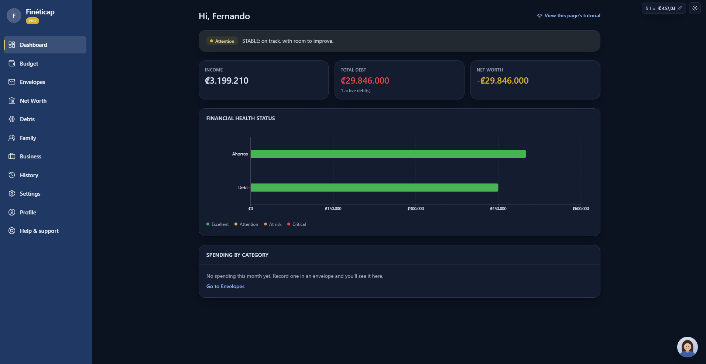
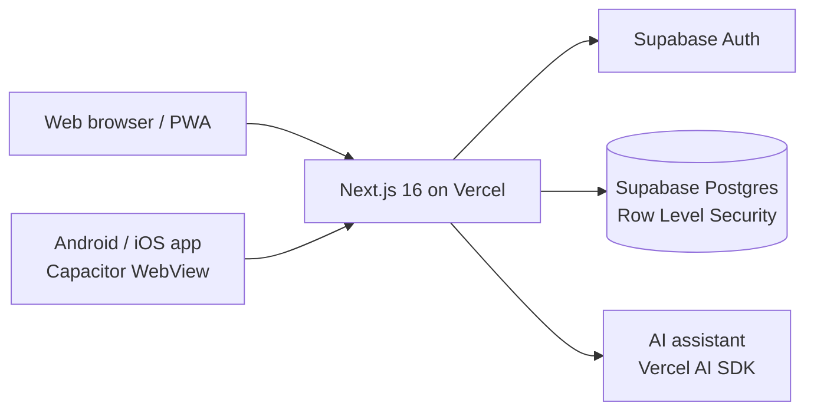
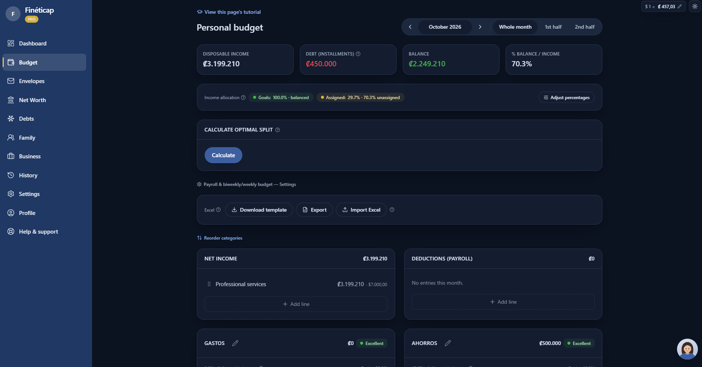
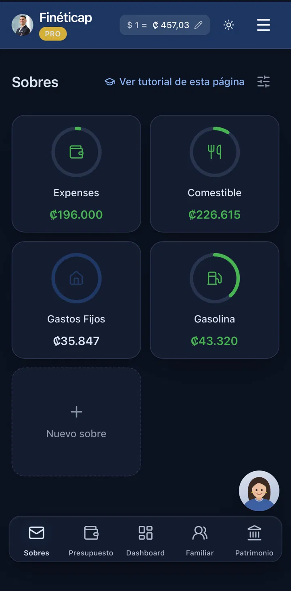

# Fineticap

**Personal and family budgeting app for Costa Rica.** Live at [fineticap.com](https://fineticap.com).

> This repository is a public showcase. The application source code is private because Fineticap is a commercial product. Happy to walk through the code in an interview.

## What it does

- **Budget by category** with traffic-light status against your own targets.
- **Net worth** tracking with financial health ratios.
- **Debt snowball plan** that simulates payoff month by month.
- **Emergency fund** tracking against a target number of months.
- **Monthly history** with a balance evolution chart.
- **Shared households:** each person has their own account and joins a family budget with a 6-character invite code.
- **In-app AI assistant** for questions about your budget.

## Architecture

| Layer | Technology |
| --- | --- |
| Frontend | Next.js 16, React, TypeScript |
| Backend & data | Supabase (Postgres, Auth) |
| Hosting | Vercel |
| Mobile | PWA + Capacitor (Android/iOS builds in progress) |
| AI | Vercel AI SDK |

## Security, stated honestly

- **Row Level Security on every table:** each household can only read and write its own data. RLS is the real privacy boundary, not the UI.
- **Encryption:** TLS in transit and encryption at rest, provided by Supabase. There is no column-level encryption today, so I don't call this "bank-level security".
- **In progress:** TOTP two-factor authentication with backup codes.

## How I build it: AI-native workflow

I develop Fineticap with Claude Code as a pair-programmer:

1. I write the spec: scope, data model changes, constraints and what must not be touched.
2. I turn it into a precise prompt with concrete verification steps.
3. Claude Code implements; I review the code, run the build and test the flow.
4. Database changes always ship as incremental SQL migrations, never full schema rewrites.

I own the architecture, the security decisions and the verification. AI does most of the typing.

## Roadmap

- [x] Budget, net worth, debt plan, emergency fund, monthly history
- [x] Shared households with invite codes
- [x] Rebrand, custom domain and PWA
- [ ] Security hardening and public security page
- [ ] Two-factor authentication (TOTP)
- [ ] Multiple savings funds with projections
- [ ] Subscription plans with a Costa Rican payment gateway
- [ ] Google Play and App Store release

## Screenshots

| Dashboard | Budget | Mobile |
| --- | --- | --- |
|  |  |  |

## Author

**Jesus Rojas García** · [GitHub](https://github.com/jrojasgarcia99) · [LinkedIn](https://www.linkedin.com/in/jesus-rojas-25389b193) · jrojasgarcia99@outlook.com
